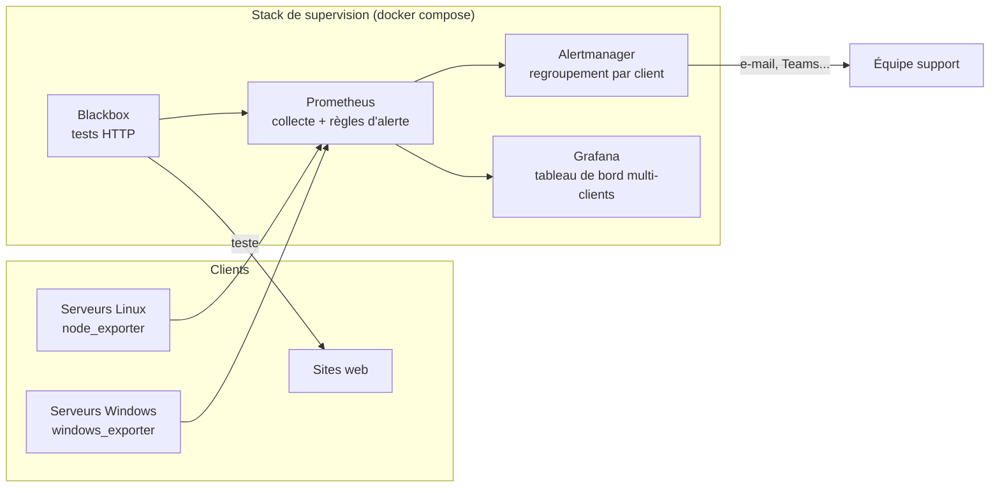

# Supervision multi-clients pour ESN

Une stack de supervision prête à l'emploi pour une ESN ou un infogérant qui gère l'informatique de plusieurs PME : serveurs Linux et Windows, sites web, certificats, espace disque. Chaque machine est rattachée à un **client**, ce qui permet de voir d'un coup d'œil chez qui il faut intervenir.

Tout se lance avec une seule commande, sur un poste ou un serveur qui a Docker, et tout est décrit dans des fichiers versionnés : rien ne se configure à la main dans une interface.


## Ce que ça surveille

| Quoi | Comment | Alerte si |
|---|---|---|
| Serveurs Linux | agent `node_exporter` (port 9100) | injoignable 5 min, disque < 10 % libre, mémoire > 95 % |
| Serveurs Windows | agent `windows_exporter` (port 9182) | injoignable 5 min, disque < 10 % libre |
| Sites web | test HTTP depuis l'extérieur (`blackbox_exporter`) | site en panne 3 min, certificat qui expire dans moins de 14 jours |

## Architecture



## Démarrage rapide

Prérequis : [Docker Desktop](https://www.docker.com/products/docker-desktop/) (Windows ou macOS) ou Docker sur Linux.

```bash
git clone https://github.com/clementsimier1-art/supervision-multi-clients.git
cd supervision-multi-clients
docker compose up -d
```

Puis ouvrir :

| Service | Adresse | Rôle |
|---|---|---|
| Grafana | http://localhost:3000 (admin / `changez-moi`) | tableau de bord « Vue multi-clients » |
| Prometheus | http://localhost:9090 | mesures, cibles, alertes |
| Alertmanager | http://localhost:9093 | alertes en cours, regroupées par client |

Pour changer le mot de passe Grafana : `GRAFANA_MOT_DE_PASSE=monmotdepasse docker compose up -d`.

Un client fictif, `client-demo`, est déjà configuré pour voir des données tout de suite.

## Ajouter un client

Un client = un fichier par type de cible dans le dossier `cibles/`. Prometheus relit ce dossier tout seul, sans redémarrage.

```yaml
# cibles/windows/boulangerie-martin.yml
- targets: ["srv-ad01.martin.local:9182", "srv-fichiers.martin.local:9182"]
  labels:
    client: boulangerie-martin
```

Même principe pour `cibles/linux/` et `cibles/web/` (une liste d'adresses de sites).

## Qualité : tests et pipeline

À chaque modification, [GitHub Actions](.github/workflows/verifier.yml) :

1. vérifie la syntaxe de tous les fichiers YAML ;
2. valide les configurations Prometheus et Alertmanager avec leurs outils officiels ;
3. **teste les alertes** ([prometheus/tests](prometheus/tests/alertes_test.yml)) : on simule une panne et on vérifie que l'alerte part au bon moment, et pas avant ;
4. démarre réellement la stack et vérifie que chaque service répond, que les mesures arrivent et que le tableau de bord est créé ([scripts/verifier-stack.sh](scripts/verifier-stack.sh)).

Une modification qui casse quelque chose est bloquée avant d'arriver en production.

## Feuille de route

- [x] Stack Prometheus, Alertmanager, Grafana, Blackbox en docker compose
- [x] Alertes testées automatiquement et pipeline CI
- [ ] Déploiement automatique des agents sur les serveurs clients avec Ansible
- [ ] Remontée de l'état des sauvegardes Veeam (script PowerShell + collecteur textfile de windows_exporter)
- [ ] Envoi des alertes par e-mail ou Microsoft Teams
- [ ] Déploiement de la stack sur un serveur avec Ansible

## Auteur

Projet de Clément Simier, administrateur systèmes & réseaux ([LinkedIn](https://www.linkedin.com/in/clément-simier-605312241)).
